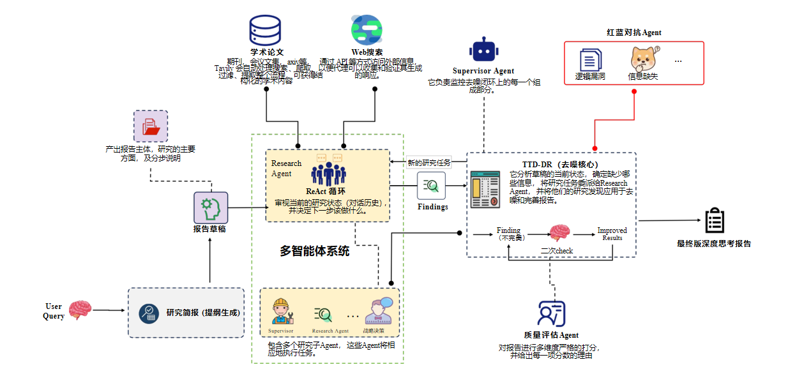
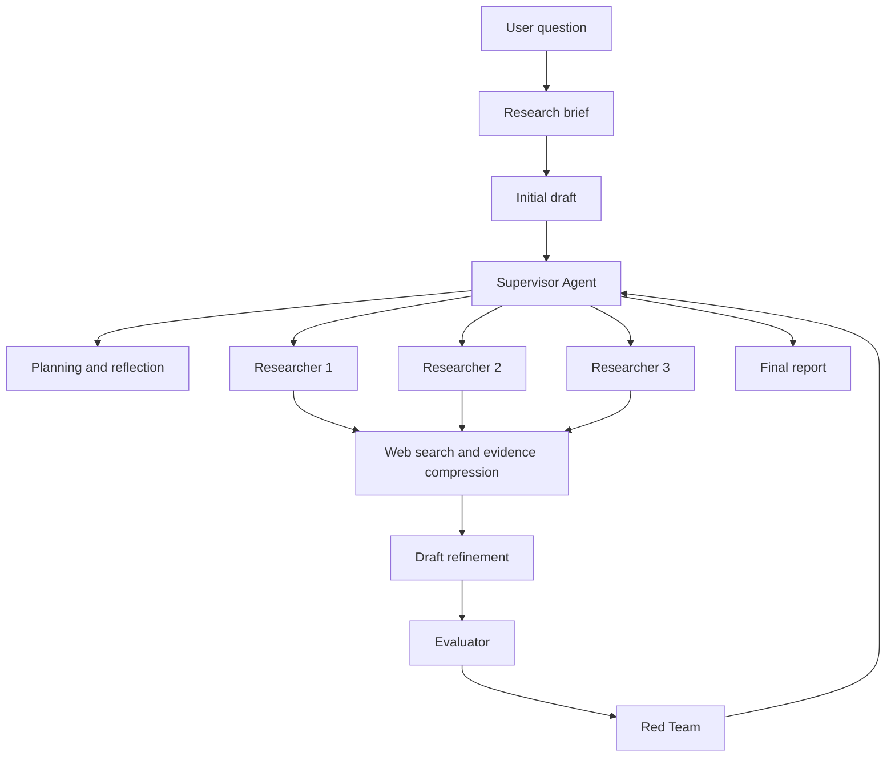

# Deep Research Agent

<p align="center">
  
</p>

A hierarchical multi-agent research system built with LangGraph. It decomposes open-ended questions, coordinates parallel web research, iteratively improves a draft, evaluates report quality, and produces a structured Markdown report with citations.

## Architecture



The Supervisor Agent is the decision-making hub. It decomposes research topics, dispatches independent Researcher Agents, reviews accumulated findings, decides when to refine the report, and terminates the workflow. Evaluator and Red Team agents provide separate quality-control signals.

## Features

- Hierarchical orchestration with LangGraph `StateGraph` and `Command`
- Parallel execution of independent research units
- Iterative search, reflection, evidence summarization, and compression
- Pluggable search-provider registry with Tavily as the default backend
- Structured outputs for research briefs, drafts, summaries, and evaluations
- Multi-dimensional report evaluation and adversarial review
- Role-based model configuration and centralized logging
- In-memory checkpointing example for resumable notebook execution

## Project structure

```text
.
|-- deep_research/
|   |-- agents/       # Draft, researcher, supervisor, evaluator and red-team agents
|   |-- prompts/      # Prompt templates for each stage
|   |-- providers/    # Optional search-provider integrations
|   |-- states/       # LangGraph state and structured-output schemas
|   |-- tools/        # Search, reflection and report-refinement tools
|   |-- agent_builder.py
|   |-- llm.py
|   |-- logging.py
|   `-- utils.py
|-- results/          # Sanitized sample reports
|-- config.yml        # Non-secret model and search configuration
|-- env.example       # Environment-variable template
|-- requirements.txt
`-- run.ipynb         # Interactive example
```

## Quick start

### 1. Create an environment

```bash
python -m venv .venv
```

Activate it and install the dependencies:

```bash
pip install -r requirements.txt
```

### 2. Configure credentials

Copy `env.example` to `.env`, then provide your own credentials:

```dotenv
OPENAI_API_KEY=your_openai_api_key
TAVILY_API_KEY=your_tavily_api_key
```

If you use an OpenAI-compatible endpoint, set `OPENAI_API_BASE` as well. Model names and role assignments can be changed in `config.yml`.

Never commit `.env` or real credentials. They are excluded by `.gitignore`.

### 3. Run the notebook

```bash
jupyter notebook run.ipynb
```

The notebook compiles the graph with an `InMemorySaver`, submits a research question, renders the workflow, and writes the final report as Markdown.

## Configuration

`config.yml` separates model selection by role, including Supervisor, Researcher, Writer, Evaluator, Red Team, summarizer, and compressor. The selected stage can be changed with the `STAGE` environment variable, and an alternative configuration path can be supplied through `CONFIG_PATH`.

## Example outputs

Sanitized generated reports are available in the [`results`](./results) directory. They demonstrate long-form analysis, comparison tables, engineering recommendations, and source lists.

## Security

- Keep API keys in `.env` or a secret manager.
- Do not place credentials, private endpoints, personal identifiers, or customer data in `config.yml`, notebooks, prompts, or sample reports.
- Clear notebook outputs before publishing if they contain private queries or runtime logs.
- Review generated reports before sharing because external webpages and model outputs are untrusted content.

## Disclaimer

This repository is a research prototype. Generated reports may contain incomplete, outdated, or incorrectly attributed information. Verify important claims and citations before using them for production or high-stakes decisions.
